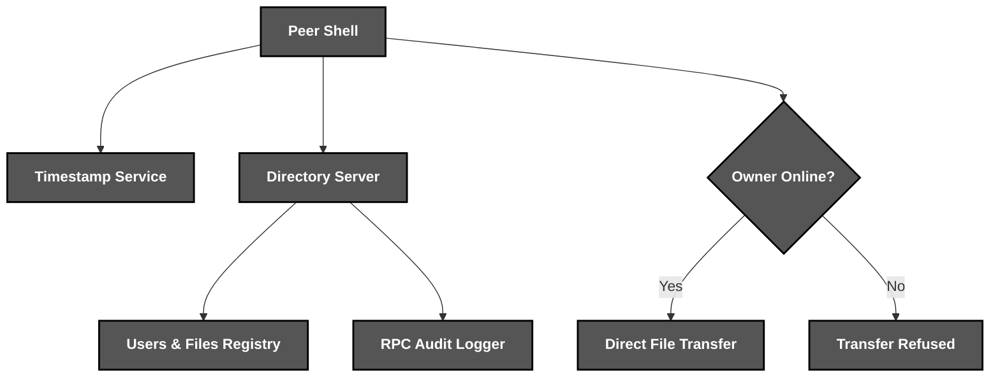
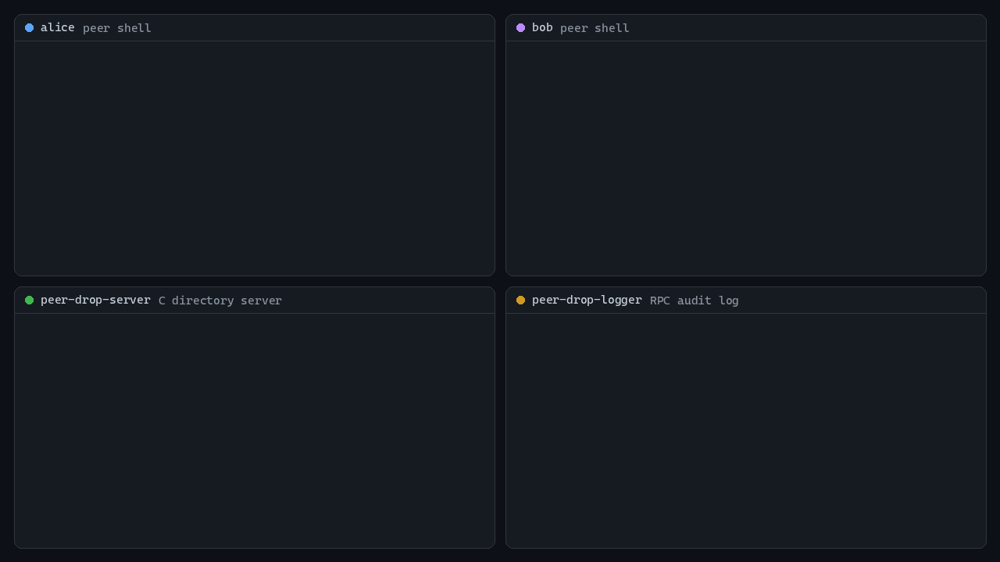

<div align="center">



*A **peer-to-peer** file sharing system with an **RPC** audit log*

</div>

# 📝 **Description**

<div align="center">

***PeerDrop*** is a **peer-to-peer file sharing system** where users publish files to a C directory server and download them straight from each other, with every operation logged over ***RPC***
</div>
<br>
<div align="right">

***It was born as a fourth-year university project*** 🎓

</div>

# 🛠️ **PeerDrop Architecture & Workflow**

<div align="center">


</div>

# 📁 **Project Structure**

```
peer-drop/
├── .dockerignore                                       # Docker Ignore Rules
├── .env.example                                        # Configuration Example
├── .gitattributes                                      # Git Attributes Configuration
├── .gitignore                                          # Git Ignore Rules
├── compose.yaml                                        # Whole System in Docker
├── Dockerfile                                          # Server, Logger & Client Image
├── LICENSE                                             # Project License
├── Makefile                                            # C Build & Tests
├── pyproject.toml                                      # Package & Tool Configuration
├── README.md                                           # You are here! ⬅️
│
├── .github/workflows/
│   └── ci.yml                                          # Lint, Test & Docker Pipeline
│
├── assets/                                             # Visual Assets
│   ├── demo-2.gif                                      # Two Peers Sharing a File
│   └── logo.svg                                        # PeerDrop Logo
│
├── scripts/
│   └── demo.py                                         # Scripted Two-Peer Session
│
├── server/
│   ├── src/
│   │   ├── main.c                                      # Sockets, Threads & Shutdown
│   │   ├── handlers.c                                  # Command Dispatch
│   │   ├── registry.c                                  # Thread-Safe Users & Files
│   │   ├── protocol.c                                  # Wire Format Helpers
│   │   └── audit.c                                     # RPC Logging Client
│   ├── logger/logger.c                                 # RPC Audit Logger
│   ├── rpc/logger.x                                    # RPC Interface
│   └── tests/registry_test.c                           # Registry Unit Tests
│
├── src/peer_drop/
│   ├── client.py                                       # Server & Peer Operations
│   ├── peer.py                                         # File Server for Other Peers
│   ├── protocol.py                                     # Wire Format Helpers
│   ├── shell.py                                        # Interactive Peer Shell
│   └── timestamp.py                                    # Flask Timestamp Service
│
└── tests/                                              # Unit & Integration Tests
```

# 🔧 **Installation**

## 📋 Requirements

- **Python 3.10+**
- **GCC with libtirpc**

## ⚙️ Quick Setup

1. **Clone the repository**
   ```bash
   git clone https://github.com/cristiangilsanz/peer-drop.git
   cd peer-drop
   ```

2. **Install the build tools** *(Debian or Ubuntu)*
   ```bash
   sudo apt-get install build-essential pkg-config libtirpc-dev rpcsvc-proto rpcbind
   ```

3. **Build the server and the logger**
   ```bash
   make
   ```

4. **Create a virtual environment** *(recommended)*
   ```bash
   python -m venv .venv
   source .venv/bin/activate      # Windows: .venv\Scripts\activate
   ```

5. **Install the client**
   ```bash
   pip install -e .
   ```

<br>

# 🚀 **See *PeerDrop* in Action**

## 🐳 To Run Everything with Docker:

1. **Start the server, the RPC logger and the timestamp service:**

```bash
docker compose up -d
```

2. **Open a peer shell in two terminals, one for each user:**

```bash
docker compose run --rm peer
```

3. **Or watch two peers share a photo on their own:**

```bash
docker compose --profile demo run --rm demo
```

4. **Follow the audit log as operations arrive:**

```bash
docker compose logs -f logger
```

## 🖥️ To Run It Locally:

1. **Start the RPC logger:**

```bash
sudo rpcbind
./build/peer-drop-logger
```

2. **Start the server in a second terminal:**

```bash
PEER_DROP_LOGGER_HOST=127.0.0.1 ./build/peer-drop-server -p 4500
```

3. **Start the timestamp service in a third terminal:**

```bash
peer-drop-timestamp
```

4. **Open a peer shell for each user:**

```bash
peer-drop -s 127.0.0.1 -p 4500
```

## 🧪 To Run the Tests:

1. **Install the development tools:**

```bash
pip install -e ".[dev]"
```

2. **Run the tests and the linter:**

```bash
make test
pytest
ruff check .
```

# 🎬 **Live Session**

<div align="center">
    
</div>

<br>

## ⌨️ Commands

<div align="center">

| Command | Action | Description |
|:---:|---|---|
| `REGISTER <user>` | Register User | Creates an account on the server |
| `CONNECT <user>` | Connect User | Goes online and starts sharing files |
| `PUBLISH <file> <description>` | Publish File | Offers a local file to other peers |
| `DELETE <file>` | Delete File | Stops sharing a published file |
| `LIST_USERS` | List Users | Shows who is online and where |
| `LIST_CONTENT <user>` | List Content | Shows the files a user shares |
| `GET_FILE <user> <file> <local>` | Get File | Downloads a file straight from its owner |
| `DISCONNECT <user>` | Disconnect User | Goes offline |
| `UNREGISTER <user>` | Unregister User | Deletes the account |
| `QUIT` | Quit Shell | Disconnects and closes the shell |

</div>

## ⚙️ Configuration

<div align="center">

| Variable | Used By | Description |
|:---:|---|---|
| `PEER_DROP_LOGGER_HOST` | Server | Address of the RPC logger, logging is off when unset |
| `PEER_DROP_TIMESTAMP_URL` | Peer Shell | Timestamp service the peers ask for the time |
| `PEER_DROP_PORT` | Docker | Port the server listens on |

</div>

# 💡 **Tips for Best Results**

The following tips help you get the most out of ***PeerDrop***:

> - Open ***two peer shells*** and send a file from one to the other.
> - Keep the ***audit log*** open to watch every operation arrive.
> - Stop the server with ***Ctrl+C*** and see it shut down cleanly.

# 📚 **Tech Stack & Other Resources**

## 📦 Tech Stack

### 🧩 **Programming Languages**
- [C](https://en.cppreference.com/w/c)
- [Python](https://docs.python.org/3/)

### 🌐 **Networking**
- [POSIX Sockets & Threads](https://pubs.opengroup.org/onlinepubs/9799919799/)
- [ONC RPC](https://datatracker.ietf.org/doc/html/rfc5531)
- [libtirpc](https://sourceforge.net/projects/libtirpc/)

### 🕸️ **Web Service**
- [Flask](https://flask.palletsprojects.com/)

### 🐳 **Containers**
- [Docker Compose](https://docs.docker.com/compose/)

### 🧪 **Testing**
- [Pytest](https://docs.pytest.org/)

### 🧹 **Code Quality**
- [Ruff](https://docs.astral.sh/ruff/)

### ⚙️ **Continuous Integration**
- [GitHub Actions](https://docs.github.com/actions)

# 🙏 **Credits & Thanks**

This project was created together with ***Paola Herráez Bravo*** 🤝 in our fourth year of university.

Thanks to the *libtirpc* maintainers for keeping ONC RPC alive on modern Linux, and to the *Flask* team for the timestamp service's foundations ✨.

# 📄 **License**

This project is licensed under the MIT License - see the [LICENSE](LICENSE) file for details.

# 📞 **Get Help & Connect**

- 🐛 [Open an issue](https://github.com/cristiangilsanz/peer-drop/issues)
- 📧 cristiangilsanz@gmail.com

<div align="center">
  <br>

  **Made with 💖 for the Distributed Systems Community**

  [⭐ Star this repo](https://github.com/cristiangilsanz/peer-drop) | [🍴 Fork it](https://github.com/cristiangilsanz/peer-drop/fork)

  <br>

  <a href="https://www.buymeacoffee.com/cristiangilsanz" target="_blank">
    
  </a>

</div>
